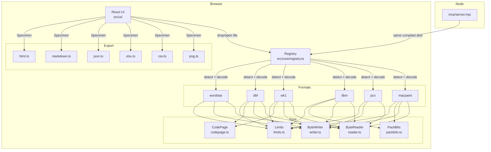

# Design Document

## Overview

Exhume is a static browser application that decodes six legacy file formats entirely on the user's
device. The system is organised around a small typed core (`src/core/`), six format modules
(`src/formats/<id>/`), an export layer (`src/export/`), a React UI (`src/ui/`), and a Node.js
stdio MCP server (`mcp/server.mjs`). Every format obeys a single `FormatModule` contract; the core
registry handles detection and dispatch; the export layer converts decoded `Specimen` values to
modern formats. No data leaves the browser.

---

## Architecture



The MCP server imports the compiled output of `src/core/registry.ts` from `dist/`; it never
re-implements format logic.

---

## Components and Interfaces

### Core TypeScript Types (`src/core/types.ts`)

```typescript
export class ExhumeError extends Error {
  constructor(message: string, public readonly formatId?: string) {
    super(message);
    this.name = "ExhumeError";
  }
}

export interface Annotation {
  label: string;
  start: number;
  end: number;
  value?: string;
  children?: Annotation[];
}

export interface Warning {
  message: string;
  offset?: number;
}

// ---- Payload shapes ----

export interface ImagePayload {
  kind: "image";
  width: number;
  height: number;
  bitsPerPixel: 1 | 4 | 8 | 24;
  palette?: [number, number, number][];
  pixels: Uint8Array;
  /** MacPaint only */
  patterns?: Uint8Array[];
}

export interface SheetCell {
  col: number;
  row: number;
  type: "blank" | "integer" | "number" | "label" | "formula";
  value: number | string | null;
  formula?: string | null;
  align?: "left" | "right" | "center" | "repeat";
  format: { type: number; decimals: number; protected: boolean };
}

export interface SheetPayload {
  kind: "sheet";
  version: "1A" | "2" | "symphony";
  range?: { startCol: number; startRow: number; endCol: number; endRow: number };
  columnWidths: Record<number, number>;
  names: Array<{ name: string; range: { startCol: number; startRow: number; endCol: number; endRow: number } }>;
  cells: SheetCell[];
}

export interface TableField {
  name: string;
  type: "C" | "N" | "F" | "L" | "D" | "M";
  length: number;
  decimals: number;
}

export interface TableRecord {
  deleted: boolean;
  values: (string | number | boolean | null)[];
}

export interface TablePayload {
  kind: "table";
  fields: TableField[];
  records: TableRecord[];
  lastUpdate: string; // "YYYY-MM-DD"
}

export interface TextRun {
  text: string;
  bold?: boolean;
  italic?: boolean;
  underline?: boolean;
  strike?: boolean;
  sup?: boolean;
  sub?: boolean;
}

export type DocumentBlock =
  | { type: "paragraph"; runs: TextRun[] }
  | { type: "pageBreak" };

export interface DocumentPayload {
  kind: "document";
  blocks: DocumentBlock[];
  header?: string;
  footer?: string;
}

export type SpecimenPayload =
  | ImagePayload
  | SheetPayload
  | TablePayload
  | DocumentPayload;

// ---- Meta ----

export interface SpecimenMeta {
  /** Images */
  width?: number;
  height?: number;
  bitsPerPixel?: number;
  /** Sheets */
  rowCount?: number;
  colCount?: number;
  /** Tables */
  recordCount?: number;
  fieldCount?: number;
  /** Documents */
  blockCount?: number;
  /** All */
  lastUpdate?: string;
  dotCommands?: string[];
}

// ---- Specimen ----

export interface Specimen {
  payload: SpecimenPayload;
  annotations: Annotation[];
  warnings: Warning[];
  meta: SpecimenMeta;
}

// ---- FormatModule ----

export interface FormatModule {
  id: string;
  name: string;
  born: number;
  died: number;
  extensions: string[];
  kind: "image" | "sheet" | "table" | "document";
  epitaph: string;
  detect(bytes: Uint8Array, fileName?: string): number; // [0,1], never throws
  decode(bytes: Uint8Array): Specimen;                  // throws only ExhumeError
  encode?(model: SpecimenPayload): Uint8Array;          // decode(encode(m)).payload deep-equals m
}
```

### ByteReader Interface (`src/core/reader.ts`)

```typescript
export interface ByteReader {
  /** Current read offset (bytes from start). */
  readonly offset: number;
  /** Total file size in bytes. */
  readonly size: number;
  /** Bytes remaining from current offset. */
  readonly remaining: number;

  u8(label: string): number;
  u16le(label: string): number;
  u16be(label: string): number;
  u32le(label: string): number;
  u32be(label: string): number;
  i8(label: string): number;
  i16le(label: string): number;
  i32le(label: string): number;
  f64le(label: string): number;
  /** Read n bytes and return a view (no copy). */
  bytes(n: number, label: string): Uint8Array;
  /** Read a NUL-terminated string, consuming up to maxLen bytes. */
  nullString(label: string, maxLen?: number): string;
  /** Group reads inside fn under a parent annotation. */
  group<T>(label: string, fn: () => T): T;
  /** Advance offset by n, recording an annotation. */
  skip(n: number, label: string): void;
  /** Seek to absolute offset (does not record an annotation). */
  seek(offset: number): void;
  /** Return collected annotations. */
  annotations(): Annotation[];
}
```

### ByteWriter Interface (`src/core/writer.ts`)

```typescript
export interface ByteWriter {
  writeU8(value: number): void;
  writeU16le(value: number): void;
  writeU16be(value: number): void;
  writeU32le(value: number): void;
  writeU32be(value: number): void;
  writeI16le(value: number): void;
  writeI32le(value: number): void;
  writeF64le(value: number): void;
  writeBytes(src: Uint8Array): void;
  /** Current write position. */
  readonly length: number;
  /** Return the written bytes as a new Uint8Array. */
  toUint8Array(): Uint8Array;
}
```

---

## Data Models

### Hard Limits (`src/core/limits.ts`)

```typescript
export const MAX_IMAGE_WIDTH       = 32_768;
export const MAX_IMAGE_HEIGHT      = 32_768;
export const MAX_IMAGE_PIXELS      = 50_000_000;
export const MAX_RECORD_COUNT      = 1_000_000;
export const MAX_FILE_SIZE         = 100 * 1024 * 1024;   // 100 MB
export const MAX_DECOMPRESSED_SIZE = 200 * 1024 * 1024;   // 200 MB

/** Throws ExhumeError if value > limit. */
export function assertLimit(value: number, limit: number, name: string): void {
  if (value > limit) {
    throw new ExhumeError(`${name} ${value} exceeds limit ${limit}`);
  }
}
```

### Registry (`src/core/registry.ts`)

Modules are registered in this fixed order: `macpaint`, `pcx`, `ilbm`, `wk1`, `dbf`, `wordstar`.
Order determines tiebreaking when two modules return equal confidence and neither extension matches.

```typescript
export function detect(
  bytes: Uint8Array,
  fileName?: string,
): Array<{ module: FormatModule; confidence: number }>;

export function identify(
  bytes: Uint8Array,
  fileName?: string,
): FormatModule | null; // returns best match with confidence >= 0.5, else null

export function dispatch(
  bytes: Uint8Array,
  fileName?: string,
): Specimen; // calls identify then module.decode; throws ExhumeError("unknown format") if no match
```

Tiebreaking in `identify`:
1. Highest confidence score wins.
2. On equal confidence, prefer the module whose `extensions` array contains the file's extension
   (case-insensitive, normalised with a leading `.`).
3. Still equal: prefer the module registered first.

### PackBits / ByteRun1 (`src/core/packbits.ts`)

Shared by MacPaint and ILBM. The codec is identical in both formats.

```typescript
/**
 * Decode a PackBits / ByteRun1 stream.
 * Stops after emitting maxOut bytes; ignores trailing input.
 * Throws ExhumeError if the stream is structurally invalid (not merely truncated).
 */
export function decodePack(src: Uint8Array, maxOut: number): Uint8Array;

/**
 * Encode src with PackBits.
 * Canonical: compress row by row when rowSize is provided; otherwise treats src as one row.
 * Runs never cross row boundaries.
 */
export function encodePack(src: Uint8Array, rowSize?: number): Uint8Array;
```

Round-trip invariant: `decodePack(encodePack(b), b.length)` deep-equals `b` for any `Uint8Array b`.

### Code Pages (`src/core/codepage.ts`)

```typescript
/** Decode a single byte using the specified code page. Returns a one-character string. */
export function cp437(byte: number): string;
export function cp850(byte: number): string;
export function cp1252(byte: number): string;
export function macRoman(byte: number): string;

/** Decode a byte array to a JS string using the given decoder. */
export function decodeBytes(
  bytes: Uint8Array,
  decode: (b: number) => string,
): string;
```

Each function is a 256-entry lookup table. Bytes 0x00–0x7F map to their ASCII equivalents in all
tables (with the control-character exceptions mandated by each standard).

Usage by format:
- **dbf**: `cp437` by default; `cp850` or `cp1252` per language driver id; unknown driver → `cp437`
  with warning if any byte ≥ 0x80 appears.
- **wk1**: bytes < 0x80 as ASCII; bytes ≥ 0x80 as ISO 8859-1 with one warning.
- **macpaint**: not needed (bitmap only; pattern data is binary, not text).
- **wordstar**: strip bit 7 to get ASCII; `cp437` is not used.
- **pcx / ilbm**: not needed (binary pixel data).

---

## Per-Format Design

### macpaint (`src/formats/macpaint/`)

**Files:** `decode.ts`, `encode.ts`, `index.ts`

**Detect:** Check for MacBinary wrapper (byte 0 = 0x00, byte 1 in 1–63, bytes 65–68 = `PNTG`) →
confidence 0.95. Without wrapper but bytes 0–3 form a plausible version u32 (0 or 2) followed by
the first byte of pattern data: confidence 0.6. File extension `.mac` / `.pntg` / `.pnt` adds 0.0
(magic is reliable enough). Pure random bytes: near 0.

**Decode steps:**
1. Detect and skip 128-byte MacBinary wrapper if present; annotate as `"macBinaryHeader"`.
2. `r.group("documentHeader", () => ...)`: read version u32; warn if not 0 or 2; read 38 × 8-byte
   patterns as `r.bytes(8, "pattern[n]")`; skip padding to offset 512.
3. `r.group("bitmap", () => ...)`: call `decodePack(remaining, 51_840)` row by row; fill with white
   and warn if input exhausted early. Annotate each row's compressed bytes.
4. If bytes remain after row 720, annotate as `"slack"` (no warning).

**Encode:** Write 512-byte header (version = 2, all 38 patterns from model), then PackBits-compress
each of the 720 rows individually. No MacBinary wrapper in output.

**Edge cases:** truncated compressed stream (fill + warn); wrong version (warn, continue); MacBinary
with non-`PNTG` file type (treat as raw, lower confidence).

---

### pcx (`src/formats/pcx/`)

**Files:** `decode.ts`, `encode.ts`, `index.ts`

**Detect:** Byte 0 = 0x0A → confidence 0.7; version byte 0, 2, 3, 4, 5 → 0.85; also check that
encoding byte is 0 or 1 and bitsPerPixel is 1, 2, 4, or 8. Extension `.pcx` adds nothing over magic.

**Decode steps:**
1. Throw `ExhumeError("not a PCX file")` if byte 0 ≠ 0x0A.
2. `r.group("header", () => ...)`: read all 128 header fields.
3. Compute width/height from xMin/yMin/xMax/yMax; apply `assertLimit` for MAX_IMAGE_WIDTH, MAX_IMAGE_HEIGHT, MAX_IMAGE_PIXELS.
4. Reject unsupported layout with `ExhumeError("unsupported PCX layout")`.
5. For 2 bpp: add CGA warning, synthesise fixed palette.
6. For encoding=0: add uncompressed warning and read raw scanlines.
7. For encoding=1: RLE-decode entire pixel data into a flat buffer, then slice into scanlines. Tolerate run sequences crossing scanline boundaries during decode.
8. For 8 bpp × 1 plane with version=5: seek to `fileLength − 769`; if byte = 0x0C read 256 RGB triples; else greyscale ramp + warning.
9. Compose pixels from planes according to layout.

**Encode:** Write canonical 128-byte header, RLE-encode scanlines (each literal value ≥ 0xC0 written as a run of 1). Write VGA palette for 8 bpp × 1 plane output.

**Edge cases:** xMax < xMin (treat as zero-width, ExhumeError); missing VGA palette (greyscale + warn); planar width padding (ignore bytes beyond actual width in bytesPerLine).

---

### ilbm (`src/formats/ilbm/`)

**Files:** `decode.ts`, `encode.ts`, `index.ts`

**Detect:** Bytes 0–3 = `FORM` and bytes 8–11 = `ILBM` or `PBM ` → confidence 0.95. `FORM` present but wrong subtype → 0.1. Neither → 0.

**Decode steps:**
1. Throw `ExhumeError("not an IFF ILBM file")` if container magic fails.
2. `r.group("IFF", () => ...)`: read outer FORM header.
3. Parse chunk stream: for each chunk read 4-byte id, u32be size, skip 1 pad byte if size is odd; unknown chunks annotated with id and skipped.
4. BMHD: decode 20-byte header fields; validate nPlanes ∈ {1..8, 24}.
5. CMAP: read `size/3` RGB triples; if absent, build greyscale ramp + warn.
6. CAMG: read u32 flags; extract HAM (bit 0x0800) and EHB (bit 0x0080).
7. BODY: allocate output pixel buffer; for each row decode `nPlanes` plane rows (ByteRun1 each if compressed=1, else raw). Interleave planes to pixel indices. If HAM: apply HAM6 algorithm row by row. If EHB: expand palette to 64 entries.
8. For `PBM ` with nPlanes=8: decode chunky bytes, one per pixel, even-padded rows.
9. Apply `assertLimit` on width, height, pixel count.

**Encode:** Write FORM/ILBM, BMHD, CMAP, optional CAMG, BODY with ByteRun1 compression per plane row. For EHB: write 64-entry CMAP. For 24-bit: nPlanes=24, no CMAP.

**Edge cases:** missing BODY (warn + empty pixels); CMAP size not divisible by 3 (truncate to `floor(size/3)` and warn); masking plane (decode and discard); HAM row restart (each row restarts from palette colour 0).

---

### dbf (`src/formats/dbf/`)

**Files:** `decode.ts`, `encode.ts`, `index.ts`

**Detect:** Version byte at offset 0 ∈ {0x03, 0x83, 0x04, 0x8B, 0x30, 0x31, 0xF5} → confidence 0.6;
also check that header length aligns with 32 + 32*N + 1 for small N → 0.8. Extension `.dbf` →
+0.15 on top of byte check (capped at 1.0).

**Decode steps:**
1. `r.group("header", () => ...)`: read version, lastUpdate (YY+1900/MM/DD), recordCount u32,
   headerLength u16, recordLength u16; note language driver at byte 29. Warn for FoxPro versions.
2. `r.group("fieldDescriptors", () => ...)`: read 32-byte descriptors until 0x0D terminator; extract
   name (NUL-padded 11 bytes), type char, length, decimals.
3. `r.seek(headerLength)`: jump to record data.
4. For each record (up to MIN(recordCount, actual fitting records)):
   - `r.group("record[n]", () => ...)`: read flag byte, then fields in order.
   - Decode each field per type: C trim right; N/F parse number + keep raw; D → ISO date; L → bool/null; M → null + warn once.
   - Apply code page decoder to C fields.
5. If record count header disagrees with file size: decode what fits + warn.
6. If 0x1A trailer present: annotate.

**Encode:** Write 32-byte header, field descriptors, 0x0D terminator, records with correct fixed widths, 0x1A trailer. Version = 0x03.

**Edge cases:** language driver for high bytes; field name with embedded NUL (truncate at first NUL); record length mismatch (use computed length from fields, warn if header disagrees).

---

### wk1 (`src/formats/wk1/`)

**Files:** `decode.ts`, `encode.ts`, `index.ts`, `formula.ts`, `xlsxFormula.ts`

**Detect:** Bytes 0–1 = 0x00 0x00 (record type BOF) and bytes 4–5 = 0x04 0x04 or 0x04 0x05 or
0x04 0x06 → confidence 0.9. Extension `.wk1` / `.wks` → +0.05.

**Decode steps:**
1. Throw `ExhumeError("not a WK1 file")` if first record type ≠ 0x0000.
2. Loop: read record type u16le, length u16le, then `length` bytes.
3. Dispatch by type:
   - 0x0001 EOF: stop.
   - 0x0006 RANGE: store usedRange.
   - 0x0008 COLW1: record column width.
   - 0x000B NAME: store named range.
   - 0x000C–0x000F, 0x0010, 0x0033: decode cell records.
4. For each cell: decode format byte (bit 7 = protected, bits 4–6 = format type, bits 0–3 = decimals).
5. LABEL: strip alignment prefix; store align field.
6. FORMULA: call `decompileFormula(bytecode, col, row)`. If result is null: keep cached value, set
   formula=null, warn.
7. Apply `assertLimit` for column ≤ 255, row < limit per version.
8. Unknown record types: annotate by number, skip, no warning.

**formula.ts — `decompileFormula`:**
Reverse-Polish stack machine. Each iteration pops a control byte:
- Push number/integer/string constants.
- Push cell references: for each coordinate u16, bit 15 set → relative (sign-extend 14-bit offset +
  col/row), bit 15 clear → absolute (prefix `$`).
- Push range references similarly.
- Binary operators (+, -, *, /, ^, =, <>, <=, >=, <, >, #AND#, #OR#): pop two strings, produce
  `"left op right"`.
- Unary operators (unary minus, unary plus, #NOT#): pop one string.
- 0x04 parentheses: pop one string, wrap in `()`.
- Fixed-arity functions: pop N args, produce `@NAME(a1,a2,...)`.
- Variable-arity functions: read arg-count byte, pop that many args.
- 0x03 end: return top of stack.
- Unknown opcode: return null.

Column encoding: 0=A, 25=Z, 26=AA, 51=AZ, 52=BA, ..., 255=IV. Formula range syntax: `B2..B13`.

**xlsxFormula.ts — `translateToExcel`:**
Text-to-text transformation on the decompiled Lotus formula string.
- Strip leading `@`; rename functions per table (see Decisions).
- Replace `..` range separator with `:`.
- Replace `#AND#` with `*`, `#OR#` with `+`.
- `#NOT#(x)` → `NOT(x)`.
- If any Lotus-only token remains after substitution → return null.

**Encode:** Write BOF, RANGE, COLW1 records, NAME records, cell records in row-then-column order, EOF. FORMULA records re-encode bytecode from the decompiled formula string. If formula is null, write a NUMBER record with the cached value.

**Edge cases:** unknown opcode in formula (keep value, null formula); column/row out of range (ExhumeError); STRING record with no preceding FORMULA (store as LABEL); missing EOF record (treat as EOF on truncation).

---

### wordstar (`src/formats/wordstar/`)

**Files:** `decode.ts`, `encode.ts`, `index.ts`

**Detect:** Heuristic score (see Requirement 7.1):
- Count bytes with bit 7 set where `(b & 0x7F)` is a letter and next byte is space/punctuation → score ratio × 0.5.
- Presence of 0x8D 0x0A → +0.2.
- Lines starting with `.PA`, `.HE`, `.FO`, `.OP`, `.PN` etc. → +0.1 per distinct command found, capped at 0.2.
- NUL byte present → hard cap at 0.05.
- Pure 7-bit ASCII with no recognised dot commands → ≤ 0.1.
Maximum achievable score: 0.95.

**Decode steps:**
1. Walk bytes sequentially, maintaining toggle state (bold/underline/italic/dstrike/strike/sup/sub).
2. At line start (after CRLF or at offset 0): if next byte is `.`, read the dot command line and dispatch.
3. 0x1A (^Z): stop, annotate remaining bytes as trailing padding.
4. 0x1D + u16le-length: skip entire sequence + warn once "5.x formatting was ignored".
5. 0x0D 0x0A (hard return): end paragraph, push to blocks, reset toggle state.
6. 0x8D 0x0A (soft CR): join lines with space, continue current paragraph.
7. 0xA0: emit space.
8. 0x8A: skip.
9. For each other byte: strip bit 7, check for toggle/control bytes, else emit character into current run.
10. At EOF: flush any open paragraph.

**Encode:** Write body bytes for each paragraph, applying toggle bytes for attribute transitions; use hard CRLF to end paragraphs; use `.HE`/`.FO` dot commands for header/footer; set bit 7 on last character of each word as a word-end marker.

**Edge cases:** 5.x sequences (skip + warn once); file with no high-bit bytes (may still be WordStar if dot commands present); overprint ^H (drop both chars); inactive soft hyphen 0x1E (drop).

---

## Lotus Formula Decompiler and Excel Translator

### `decompileFormula(bytecode, col, row): string | null`

Located at `src/formats/wk1/formula.ts`.

Processes the formula's reverse-Polish bytecode. The stack holds string representations of
sub-expressions. Opcode handling:

| Opcode range | Action |
|---|---|
| 0x00 | Read f64, push numeric literal string |
| 0x01 | Read col u16, row u16; compute A1 label (relative/absolute); push |
| 0x02 | Read startCol, startRow, endCol, endRow u16; push range like `B2..B13` |
| 0x03 | End of formula: pop and return top |
| 0x04 | Parentheses: pop top, push `(top)` |
| 0x05 | Read i16, push integer string |
| 0x06 | Read NUL-terminated string, push quoted string |
| 0x08 | Unary minus: pop, push `−top` |
| 0x17 | Unary plus: pop, push `+top` |
| 0x09–0x0D | Binary `+ − * / ^`: pop two, push `left op right` |
| 0x0E–0x13 | Binary `= <> <= >= < >` |
| 0x14 | `#AND#`: pop two, push `left#AND#right` |
| 0x15 | `#OR#`: pop two, push `left#OR#right` |
| 0x16 | `#NOT#`: pop one, push `#NOT#(top)` |
| 0x1F–fixed | Fixed-arity @function: pop N args, push `@NAME(a,b,...)` |
| 0x30,0x50–0x58 | Variable-arity: read arg-count byte, pop that many, push |
| unknown | Return null |

**Relative reference rendering:** for a relative coordinate u16 `c`, the low 14 bits are a signed
value (bit 13 is sign; sign-extend to 14 bits): `signedOffset = (c & 0x2000) ? (c & 0x3FFF) - 0x4000 : c & 0x3FFF`. Add to the formula's own col or row; render as a plain column letter and 1-based row number.

**Absolute reference:** bit 15 clear → no sign-extension; use raw value; prefix with `$`.

### `translateToExcel(lotusFormula): string | null`

Located at `src/formats/wk1/xlsxFormula.ts`.

Function name mapping (Lotus → Excel):

| Lotus | Excel |
|---|---|
| @SUM | SUM | @AVG | AVERAGE |
| @COUNT | COUNT | @MIN | MIN |
| @MAX | MAX | @STD | STDEV |
| @VAR | VAR | @NPV | NPV |
| @IRR | IRR | @PMT | PMT |
| @PV | PV | @FV | FV |
| @IF | IF | @ABS | ABS |
| @INT | INT | @SQRT | SQRT |
| @LOG | LOG | @LN | LN |
| @PI | PI() | @SIN | SIN |
| @COS | COS | @TAN | TAN |
| @ATAN | ATAN | @ATAN2 | ATAN2 |
| @ASIN | ASIN | @ACOS | ACOS |
| @EXP | EXP | @MOD | MOD |
| @CHOOSE | CHOOSE | @HLOOKUP | HLOOKUP |
| @VLOOKUP | VLOOKUP | @ISNA | ISNA |
| @ISERR | ISERROR | @FALSE | FALSE |
| @TRUE | TRUE | @RAND | RAND |
| @DATE | DATE | @TODAY | TODAY |
| @DAY | DAY | @MONTH | MONTH |
| @YEAR | YEAR | @TIME | TIME |
| @HOUR | HOUR | @MINUTE | MINUTE |
| @SECOND | SECOND | @ISNUMBER | ISNUMBER |
| @ISSTRING | ISTEXT | @LENGTH | LEN |
| @VALUE | VALUE | @STRING | TEXT |
| @MID | MID | @CHAR | CHAR |
| @CODE | CODE | @FIND | FIND |
| @DATEVALUE | DATEVALUE | @TIMEVALUE | TIMEVALUE |
| @CELLPOINTER | (no equivalent) | @ROUND | ROUND |
| @NA | NA() | @ERR | (cell value "#VALUE!") |

Additional transformations:
- `..` range separator → `:` (e.g. `B2..B13` → `B2:B13`).
- `#AND#` → `*` (Lotus logical AND is numeric multiplication of truth values).
- `#OR#` → `+` (Lotus logical OR is numeric addition capped at 1).
- `#NOT#(x)` → `NOT(x)`.
- If `@CELLPOINTER` or any unrecognised `@NAME` remains → return null.
- `@NA` produces `NA()` as a formula string; `@ERR` produces the literal string `"#VALUE!"` stored
  as a plain string cell value (not a formula).

---

## Export Layer

### `src/export/png.ts`

Writes a minimal valid PNG using `fflate` for IDAT zlib compression. No external PNG library.

Structure: PNG signature (8 bytes) → IHDR chunk → IDAT chunk(s) → IEND chunk.

IHDR: width, height, bit depth (8 for all outputs), colour type (2=RGB for 24-bit, 3=indexed for
paletted, 0=greyscale for 1-bit), compression 0, filter 0, interlace 0.

For indexed images: write PLTE chunk from palette. For 1-bit MacPaint images: convert 1-bit pixels
to 8-bit indexed before PNG encoding (palette = [[255,255,255],[0,0,0]]).

Each scanline is prepended with a filter byte (0 = None). All scanlines concatenated form the raw
IDAT payload, compressed with `fflate.deflateSync`.

No use of `OffscreenCanvas` / `toBlob` (unavailable in workers; PNG writer avoids DOM dependency).

### `src/export/csv.ts`

RFC 4180 output: fields separated by `,`, rows terminated by `\r\n`. A field containing `,`, `"`,
or `\r` or `\n` is quoted with `"` and internal `"` doubled. Sheet exports use the formatted display
value (not the raw number). Table exports use the decoded string value for each field.

### `src/export/xlsx.ts`

Minimal OOXML writer using `fflate.zip`. ZIP entries:

```
[Content_Types].xml
_rels/.rels
xl/workbook.xml
xl/_rels/workbook.xml.rels
xl/worksheets/sheet1.xml
xl/sharedStrings.xml
```

All string cell values go into the shared strings table; cells reference by zero-based index with
`t="s"`. Number cells use `<c><v>…</v></c>`. Formula cells use `<c><f>…</f><v>…</v></c>` for
numbers or `<c t="str"><f>…</f><v>…</v></c>` for string formulas. Date values written as ISO date
strings in a string cell.

Column addresses in XML: A=1, B=2, …, Z=26, AA=27, etc.

### `src/export/json.ts`

Sheets: array of objects keyed by column address (e.g. `{"A": "Name", "B": 42}`).
Tables: array of objects keyed by field name (e.g. `{"NAME": "Smith", "AGE": 42}`).
Date values: ISO 8601 string `"YYYY-MM-DD"`. Deleted records included with a `"_deleted": true` key.

### `src/export/markdown.ts`

Each paragraph block → one or more lines separated by a blank line. Inline formatting: `**bold**`,
`_italic_`, `<u>underline</u>` (no standard Markdown for underline; use inline HTML), `~~strike~~`.
Superscript/subscript: `<sup>…</sup>` / `<sub>…</sub>`. Page breaks → `\n---\n`.

### `src/export/html.ts`

Semantic HTML5 fragment (no `<html>/<body>` wrapper; caller wraps if needed). Paragraphs in `<p>`.
Inline: `<strong>`, `<em>`, `<u>`, `<s>`, `<sup>`, `<sub>`. Page breaks → `<hr>`.

---

## UI Component Tree and State

```
App
├── Graveyard              — home page; six FormatTombstones + DropZone
│   ├── FormatTombstone    — id, name, born/died, epitaph, hover lift animation
│   └── DropZone           — keyboard accessible, aria-label, drag-and-drop
├── Viewer (routed by specimen.payload.kind)
│   ├── ImageViewer        — <canvas> pixelated, integer zoom controls
│   ├── SheetViewer        — virtual grid, formula bar, A..IV column headers
│   ├── TableViewer        — column headers, rows, deleted-row toggle
│   └── DocumentViewer     — paragraph and run rendering, page break visual
├── Autopsy
│   ├── HexPane            — 16 bytes/row, coloured annotation spans
│   └── AnnotationTree     — collapsible; bidirectional selection with HexPane
├── ExportBar              — format-appropriate export buttons
└── CornerReport           — warning list (collapsible)
```

App state shape (managed with `useReducer` at the `App` level):

```typescript
interface AppState {
  screen: "graveyard" | "viewer";
  specimen: Specimen | null;
  selectedAnnotation: Annotation | null;
  selectedOffset: number | null;
  showDeleted: boolean;
  zoom: number; // integer >= 1
}
```

No external state library. `useReducer` with a discriminated-union action type. `useState` for
local component state (e.g. the formula bar text, hover state on tombstones).

---

## MCP Server

Located at `mcp/server.mjs`. Imports `dist/core/registry.js` (the compiled TypeScript core).
Uses `@modelcontextprotocol/sdk` for stdio transport and tool registration.

All tools accept `filePath: string`. The server reads the file synchronously with `fs.readFileSync`,
converts to `Uint8Array`, then calls the registry.

**Tool: `identify`**
Input: `{ filePath: string }`
Output: `{ matches: Array<{ id: string; name: string; confidence: number }> }` sorted descending.

**Tool: `hexdump`**
Input: `{ filePath: string; offset: number; length: number }`
Output: `{ lines: string[] }` — classic format: `0000: 4D 5A 90 00  MZ..` (16 bytes/row).

**Tool: `autopsy`**
Input: `{ filePath: string }`
Output: `{ annotations: Annotation[] }` — top-level annotation array from the decoded Specimen.

**Tool: `decode`**
Input: `{ filePath: string }`
Output: `{ specimen: Specimen }` — full payload, annotations, warnings, meta.

Error handling: `ExhumeError` → return `{ error: string }` as tool content (no crash). Any other
error propagates and kills the server process.

---

## Error Handling

- `ExhumeError` is the only error format decoders may throw. It signals that the file is unusable or
  unrecognisable. It carries an optional `formatId` for context.
- `detect()` must never throw. Any internal error is caught and returns 0.
- The UI dispatches in a `try/catch`. On `ExhumeError` it shows the message in an inline error
  region with `role="alert"`. On any other error it shows a generic "unexpected error" message and
  logs to `console.error`.
- MCP tools: catch `ExhumeError`, return `{ error: message }` as the tool result content. All other
  errors propagate (the MCP SDK handles process exit).
- Warning deduplication: each decoder accumulates warnings in an array; before returning the
  Specimen, it deduplicates by `message` string, keeping the first occurrence's `offset`.

---

## Testing Strategy

Each format module has two test files alongside its source:

- `*.test.ts` — example-based tests: decode known byte sequences, verify exact payload fields,
  verify specific warnings, verify rejection of bad magic.
- `*.prop.test.ts` — property-based tests using fast-check with minimum 100 runs per property.

Properties P1–P4 (from `steering/formats.md`) apply to every format:

- **P1 round-trip:** `decode(encode(m)).payload` deep-equals `m` for arbitrary valid models.
- **P2 total:** for arbitrary bytes, `detect` returns a number in [0,1] and `decode` either returns
  a Specimen or throws `ExhumeError`; never hangs, never throws other errors.
- **P3 annotations honest:** every annotation lies within the file bounds; for files from `encode`,
  top-level annotations cover every byte exactly once.
- **P4 truncation survivable:** decoding any prefix of a valid encoded file never throws a
  non-`ExhumeError`; if it returns a Specimen that was cut short it carries at least one warning.

Additional per-module tests:
- **macpaint:** PackBits decompress with known runs; patterns round-trip; MacBinary skip.
- **pcx:** RLE with run crossing scanline boundary; VGA palette detection; unsupported layout throws.
- **ilbm:** HAM6 pixel computation for all four control values; EHB half-brightness palette; PBM chunky decode.
- **wk1:** formula decompiler for each opcode category; relative/absolute reference rendering; unknown opcode returns null.
- **dbf:** all field types; language driver selection; deleted record flag.
- **wordstar:** toggle control bytes; soft-CR line joining; dot command dispatch; 5.x sequence skip.

Property tests also cover:
- PackBits round-trip (P5).
- PCX RLE round-trip (P6).
- CSV round-trip (P7).
- WK1 formula decompile/re-encode (P8).
- XLSX valid ZIP with all cells (P9).

---

## Correctness Properties

*A property is a characteristic or behavior that should hold true across all valid executions of a
system — essentially, a formal statement about what the system should do. Properties serve as the
bridge between human-readable specifications and machine-verifiable correctness guarantees.*

### Property 1: Format round-trip (P1) — all formats

*For any* valid `SpecimenPayload` model `m` of any supported format, encoding `m` with the format's
`encode` function and then decoding the result with `decode` produces a payload that deep-equals `m`.

**Validates: Requirements 2.7, 3.7, 4.9, 5.9, 6.9, 7.9, 20.3**

### Property 2: Decoder totality (P2) — all formats

*For any* `Uint8Array` of arbitrary bytes and any optional filename string, calling `detect` returns
a number in the closed interval [0, 1] and never throws; calling `decode` on those same bytes either
returns a `Specimen` or throws `ExhumeError` and never throws any other kind of error and never hangs.

**Validates: Requirements 1.5, 8.2, 8.5**

### Property 3: Annotation honesty (P3) — all formats

*For any* file produced by a format's `encode` function, the top-level annotations of the resulting
decoded `Specimen` cover every byte index from 0 to `fileSize − 1` exactly once — no index appears
in two annotations, and no index is absent from all annotations.

**Validates: Requirements 9.3, 9.6**

### Property 4: Truncation survivability (P4) — all formats

*For any* valid encoded file `F` and any prefix length `k` where `0 ≤ k ≤ |F|`, decoding the first
`k` bytes of `F` either returns a `Specimen` or throws `ExhumeError`; it never throws any other
error. If `k < |F|` and a Specimen is returned, that Specimen carries at least one warning.

**Validates: Requirements 8.3, 8.4**

### Property 5: PackBits round-trip

*For any* `Uint8Array` `b` of length up to 4096 bytes, encoding `b` with `encodePack` and then
decoding the result with `decodePack(output, b.length)` produces a byte array that deep-equals `b`.

**Validates: Requirements 2.4, 2.5, 4.6**

### Property 6: PCX RLE round-trip

*For any* `Uint8Array` `b` of arbitrary length, encoding `b` with the PCX RLE encoder and then
decoding the result with the PCX RLE decoder produces a byte array that deep-equals `b`.

**Validates: Requirements 3.4**

### Property 7: CSV export round-trip

*For any* two-dimensional array of strings (with no embedded NUL characters), exporting to CSV and
then parsing the resulting CSV back to cell strings produces an array that deep-equals the original.

**Validates: Requirements 16.1, 16.2**

### Property 8: WK1 formula decompile/re-encode round-trip

*For any* generated formula expression tree (covering all supported operators and functions in
`docs/formats/wk1.md`), encoding the tree to WK1 bytecode, decompiling it with
`decompileFormula`, re-encoding from the decompiled string, and decompiling again produces the same
formula string as the first decompile.

**Validates: Requirements 6.6, 6.7**

### Property 9: XLSX output is a valid ZIP containing every cell

*For any* `SheetPayload` or `TablePayload` with up to 10 000 cells, the byte sequence produced by
the XLSX exporter is a valid ZIP archive (parseable by `fflate.unzip`) containing a file at
`xl/worksheets/sheet1.xml` whose text includes the value of every non-blank cell from the payload.

**Validates: Requirements 17.4**

### Property 10: `detect` safety for arbitrary bytes

*For any* `Uint8Array` of arbitrary length including zero bytes, every registered `FormatModule`'s
`detect` function returns a number in [0, 1] and never throws.

**Validates: Requirements 1.5, 8.5**

### Property 11: Annotation full coverage from `encode`

*For any* valid model `m` of any format with an `encode` function, the top-level annotation array
returned from `decode(encode(m))` covers every byte at exactly one span — equivalent to checking
that the union of all top-level `[start, end)` intervals equals `[0, fileSize)` with no overlaps.

**Validates: Requirements 9.3**

### Property 12: Truncation never causes non-ExhumeError

*For any* valid encoded file `F` and any non-negative integer `k ≤ |F|`, passing `F.slice(0, k)` to
`decode` either returns a `Specimen` or throws an `ExhumeError`; the thrown error is never an
instance of any other error class.

**Validates: Requirements 8.2, 8.3**

---

## Decisions

**PNG encoding approach:** Custom minimal PNG writer using `fflate.deflateSync` rather than
`OffscreenCanvas.convertToBlob`. Rationale: `OffscreenCanvas` is unavailable in some contexts
(service workers on Safari), introduces browser quirks in colour-space handling, and would make PNG
output non-deterministic. The custom writer is small (~120 lines) and produces identical output
across all environments, which is required by the round-trip property.

**WordStar detection threshold:** Pure 7-bit ASCII with no recognised dot commands → confidence ≤ 0.1.
Rationale: plain text files would otherwise match at low confidence. The threshold prevents false
positives while still detecting even lightly-formatted WordStar files that have soft-word-end bytes.

**Lotus → Excel `#AND#` → `*`, `#OR#` → `+`:** Lotus logical AND/OR are numeric (non-zero = true,
zero = false); `A*B` and `A+B` preserve this semantics in Excel. Mapping to `AND()`/`OR()` would
change semantics for numeric inputs. This matches the documented Lotus behaviour.

**`@NA` → `NA()`, `@ERR` → `"#VALUE!"` as cell string:** `@NA` has a direct Excel formula
equivalent. `@ERR` has no clean equivalent; writing the literal string `"#VALUE!"` preserves the
cell's intent (an error marker) without producing a formula that Excel may evaluate differently.

**EHB palette always expanded to 64 entries:** The spec says indices 32–63 map to colours 0–31 at
half brightness. Expanding unconditionally means consumers always see a full 64-entry palette
regardless of whether CMAP had 32 or 64 entries. This simplifies downstream code and avoids a
conditional on palette size.

**HAM6 row-restart from palette colour 0:** Each ILBM row restarts hold-and-modify from colour 0,
not from the last colour of the previous row. This matches the Amiga hardware behaviour and the EA
IFF 85 specification.

**Sniffing threshold ≥ 0.5:** Below 0.5 the best-match confidence is too low to decode reliably.
An unknown-format error is clearer to the user than a garbled Viewer. Any format producing 0.5 on
its own magic bytes is a miscalibrated detector; the threshold serves as a circuit breaker.

**ByteReader annotation granularity:** Every named field is a leaf annotation spanning exactly the
bytes consumed. `group()` creates a parent annotation whose span is the union of its children's
spans. The decoder never manually sets annotation offsets; `ByteReader` infers them from the read
cursor.

**XLSX formula fallback:** When `translateToExcel()` returns null (Lotus-only construct), the cell
is written as a plain number cell with the cached `f64` value. This avoids broken formula syntax in
Excel while still conveying the numeric result. A warning is added to the Specimen per Requirement 17.2.

**LICS / ISO 8859-1 for WK1:** WK1 text bytes ≥ 0x80 are decoded as ISO 8859-1 (Latin-1) with one
warning per file. A full LICS table is not implemented; the bytes that differ from Latin-1 are rare
in practice and the warning alerts the user to potential mojibake.

**Service worker for offline:** A Vite-generated service worker (`vite-plugin-pwa` or a hand-written
`sw.js`) pre-caches all static assets on first load. No user-file data ever touches the service
worker cache. The offline statement in the UI is therefore always accurate.
