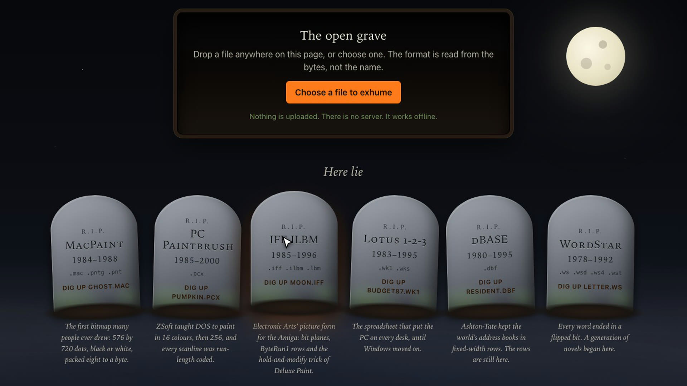
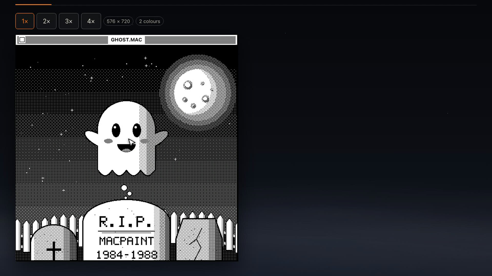
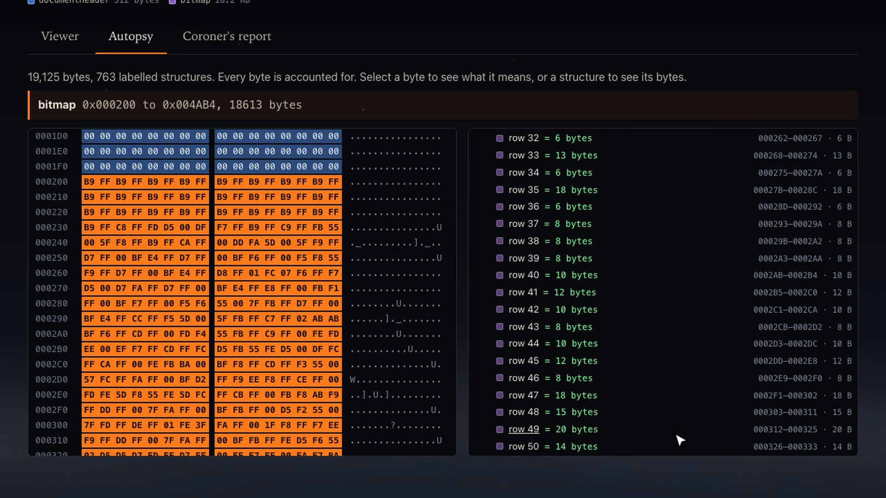
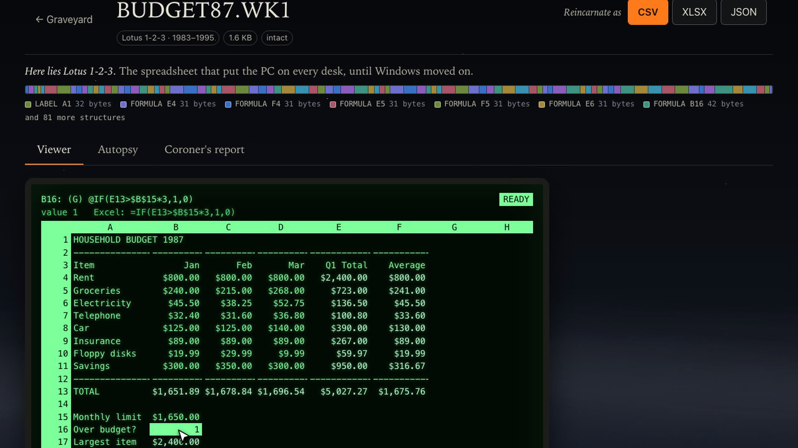
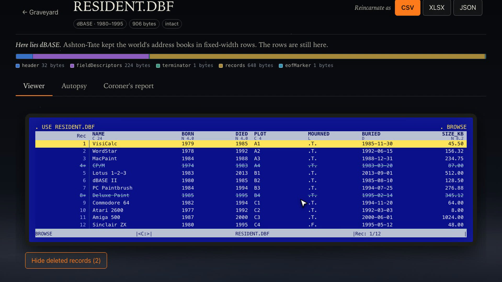
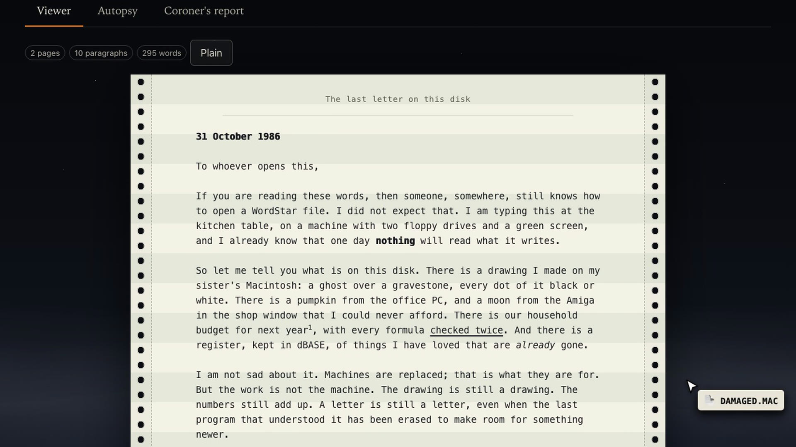
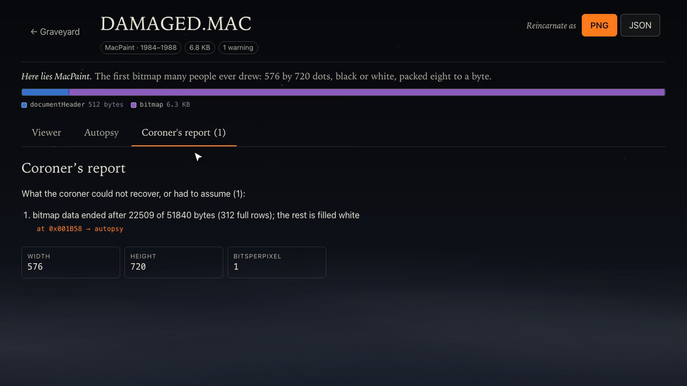

# Exhume

**Raise your dead files.** Exhume opens file formats that no current program reads, in your browser,
shows what every byte means, and hands the content back in a format that will still open tomorrow.

Kiroween 2026 entry, category **Resurrection**.

- Live app: **https://khozhijon.github.io/exhume/**
- Demo video: _added when the video is published_



## What it does

Drop a file on the page (or dig up one of the six built-in specimens):

| Format | Lived | Kind | What you get back |
|---|---|---|---|
| MacPaint (`.mac`, `.pntg`) | 1984-1988 | 1-bit picture, PackBits | PNG |
| PC Paintbrush (`.pcx`) | 1985-2000 | 1 to 24-bit picture, RLE | PNG |
| Amiga IFF ILBM (`.iff`, `.lbm`) | 1985-1996 | bit-plane picture, EHB, HAM6 | PNG |
| Lotus 1-2-3 (`.wks`, `.wk1`) | 1983-1995 | worksheet with formulas | CSV, XLSX with live formulas, JSON |
| dBASE III/IV (`.dbf`) | 1980-1995 | table, including "deleted" rows | CSV, XLSX, JSON |
| WordStar 3.x/4.0 (`.ws`) | 1978-1992 | document | Markdown, HTML, plain text |

Three rooms:

- **Viewer.** The content in a frame from its own era: a System 1 window for MacPaint, a green
  phosphor 1-2-3 screen with the control panel and the cell pointer, a dBASE `BROWSE` screen, fan-fold
  printer paper for WordStar. Lotus formulas are decompiled from their bytecode back to
  `@SUM(B4..D4)` and translated to Excel (`=SUM(B4:D4)`), so the exported workbook still calculates.
- **Autopsy.** Every byte of the file in a hex view, coloured by the structure it belongs to, next to
  a tree of everything the decoder found. Select a byte to see what it means; select a structure to
  see its bytes. The bar above the tabs is the whole file as a map.
- **Coroner's report.** What could not be recovered and why. Exhume never invents content: a
  truncated or damaged file still opens, with a list of exactly what is missing.

Everything runs in the browser tab. No upload, no server, no analytics; it works offline after the
first load.

| | |
|---|---|
|  |  |
|  |  |
|  |  |

## Why

Files do not die when the disk fails. They die when the last program that understood them stops
running. Family photos drawn in MacPaint, a parent's budget in Lotus 1-2-3, a novel in WordStar, a
club's membership list in dBASE: the bytes are still there and nothing opens them. Converters exist,
but most of them want you to upload private files to a server, and none of them show their work.
Exhume does it locally and explains every byte, so you can trust what you got back.

## How it is built

- TypeScript (strict), React, Vite. Static site, no backend.
- **No format libraries.** Each decoder in `src/formats/<id>/` is written from the published format
  descriptions (summarised with sources in [`docs/formats/`](docs/formats)). The only runtime
  dependencies are React and `fflate` (zip/deflate for the PNG and XLSX writers).
- Decoders read bytes only through `ByteReader` (`src/core/reader.ts`), which records an annotation
  for every field it reads. That is where the Autopsy comes from: it is not a second parser.
- Each format also has an **encoder**. Encoders make the built-in specimens (all original content,
  drawn and written for this project by `npm run samples`) and make the property tests possible.
- `mcp/server.mjs` is **exhume-mcp**: the same decoders as MCP tools (`identify`, `hexdump`,
  `autopsy`, `decode`), so a coding agent can look inside a binary fixture instead of guessing.

### Correctness: property-based tests

Every format passes the same four properties (`src/core/testing.ts`, fast-check):

1. **Round trip.** `decode(encode(m))` equals `m` for arbitrary valid models.
2. **Total.** Arbitrary bytes, and valid files with random bytes overwritten, give a specimen or an
   `ExhumeError`. Never another exception, never a hang.
3. **Honest annotations.** Every annotation is inside the file, and for an encoded file the top-level
   annotations tile it exactly: every byte explained once.
4. **Truncation is survivable.** Any prefix of a valid file decodes with a warning or fails cleanly.

Plus codec round trips (PackBits, PCX RLE), CSV round trip, "XLSX is a valid zip with every cell",
and for Lotus formulas: compile, decompile, compile again gives the same bytes.

```bash
npm install
npm test          # example tests + property tests
npm run dev       # http://localhost:5173
npm run build     # static site in dist/
npm run samples   # regenerate the built-in specimens
npm run mcp       # start exhume-mcp on stdio
npm run interop   # cross-check against ffmpeg's PCX and IFF codecs (needs ffmpeg)
npm run offline   # build, visit once, cut the network, reload, open every sample (needs Playwright)
```

## Built with Kiro (and what was not)

This project was built spec-first with [Kiro](https://kiro.dev). The whole `.kiro/` directory is in
the repository:

- **Spec** (`.kiro/specs/exhume-core/`): `requirements.md` (23 requirements in EARS form),
  `design.md` (architecture, types, 12 numbered correctness properties) and `tasks.md` (26 tasks)
  were generated by Kiro in spec mode from a two-page brief.
- **Steering** (`.kiro/steering/`): product promises, tech rules, structure, the format-module
  contract, UI rules.
- **Hooks** (`.kiro/hooks/`): a `PreToolUse` shell guard, two `PostFileSave` hooks (one enforces the
  product promises on every saved file, one runs the tests of the folder that was touched), a
  `SessionStart` brief, a `Stop` type-check and a `PostFileCreate` checklist.
- **Custom agents** (`.kiro/agents/`): `gravedigger` implements one spec task; `coroner` reviews
  against the spec and may not edit source.
- **MCP** (`.kiro/settings/mcp.json`): the project's own `exhume-mcp` server, used by the agents.
- **Transcripts** of every Kiro session, with per-session credit cost, are in
  [`docs/kiro-sessions/`](docs/kiro-sessions); reviews of Kiro's work are in
  [`docs/reviews/`](docs/reviews).

**Who did what.** Lead developer: Khozhijon. I led the project from idea to submission and
directed an AI pair-programmer (Claude Code) that helped write the code,
which I reviewed and tested.

The entry was built on Kiro's free tier (50 credits a month), which does not stretch to 26
implementation tasks. So the work was split between the two tools I directed:

- **Kiro (Kiro CLI, headless)** wrote the spec, and implemented the project scaffold, `ByteReader`
  and `ByteWriter` with their tests, PackBits, the first version of the MCP server, the samples
  generator, the Table Viewer, the Document Viewer and the offline/accessibility pass, and reviewed
  the WordStar module as the `coroner` agent.
- **The AI pair-programmer** wrote the steering documents, the format notes, the hooks and agent
  definitions, ran and reviewed every Kiro session, and implemented the rest against Kiro's
  spec: the six format modules, the export layer, the app shell, the Lotus sheet viewer, the image
  viewer and the Autopsy, plus fixes recorded in `docs/reviews/`.

[`docs/KIRO.md`](docs/KIRO.md) has the full account, including what went wrong.

## Limits

- dBASE memo files (`.dbt`) are not read; memo fields come back empty with a warning.
- WordStar 5 and later formatting sequences are skipped (with a warning); the text is kept.
- Lotus WK3/WK4 are not supported. Characters above 0x7F in worksheets are read as Latin-1, not LICS.
- The decoders were verified with generated files, hand-built fixtures, property tests and, for the
  picture formats, an independent implementation: `npm run interop` checks that ffmpeg decodes our
  PCX and IFF samples to exactly the pixels Exhume decodes, and that Exhume decodes PCX files written
  by ffmpeg (1-bit, 8-bit palette, 24-bit) to exactly the pixels ffmpeg decodes. The same script has
  checks against SheetJS for Lotus and dBASE files; those have not been run yet. Nothing has been run
  against a large collection of files from the wild.

## Licence

MIT. See [LICENSE](LICENSE). The built-in sample files are original works made for this project and
are covered by the same licence. MacPaint, Macintosh, Lotus 1-2-3, dBASE, WordStar, PC Paintbrush,
Amiga and Deluxe Paint are trademarks of their respective owners; Exhume is not affiliated with them.
